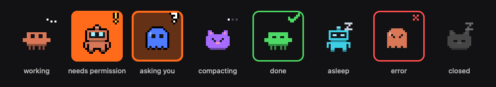

# Chencho

<p align="center">
  
</p>

Una franja flotante en el borde de la pantalla de Windows con un bicho animado en pixel art por cada sesión de Claude Code. Cada bicho muestra qué está haciendo su sesión, y los que te están esperando cuesta pasarlos por alto. Un clic en un bicho trae su terminal al frente, y en Windows Terminal, también su pestaña.

> **No es un proyecto oficial de Anthropic.** No está afiliado a Anthropic ni cuenta con su respaldo. "Claude" es una marca comercial de Anthropic, PBC.

> **Desarrollo temprano.** Puede haber detalles sin pulir.

## Requisitos y compatibilidad

- **Windows 10 u 11, x64.**
- **[.NET 9 Desktop Runtime](https://dotnet.microsoft.com/download/dotnet/9.0).** `chencho setup` comprueba que esté instalado y, si falta, muestra el enlace de descarga.
- **Claude Code instalado de forma nativa en Windows** (2.1.285 o posterior), con `claude` en el PATH. Las sesiones que corren dentro de WSL no se ven.
- **Git Bash no hace falta.** El comando de los hooks funciona igual en Git Bash y en PowerShell, que es lo que usa Claude Code para los hooks cuando Git Bash no está instalado. Está probado en bash, en PowerShell 7 y en Windows PowerShell 5.1, y también a través del propio Claude Code.
- **Cualquier terminal.** El seguimiento de las sesiones funciona con Claude Code en cualquier terminal (Windows Terminal, PowerShell, cmd, Git Bash, la terminal de VS Code…), porque sale de los hooks de Claude Code y de `claude agents`, no de la terminal.
- **Traer la terminal al frente.** Un clic en el bicho de una sesión en curso trae su terminal al frente:
  - en Windows Terminal, además selecciona la pestaña exacta;
  - en una ventana de consola clásica, enfoca esa ventana;
  - en otros programas, como VS Code, enfoca la ventana del programa (esto está menos probado).
- **Reanudar una sesión cerrada.** Un clic en una sesión cerrada la reanuda con `claude --resume` en una pestaña nueva de Windows Terminal con PowerShell 7 (`pwsh`), o con Windows PowerShell si `pwsh` no está. Sin Windows Terminal, se abre en una ventana de consola nueva.
- **Idioma.** Español o inglés, según el idioma de Windows. Se cambia desde el menú del ícono de la bandeja, en **Idioma**.
- **Para compilar** hacen falta [Bun](https://bun.sh) 1.3 o posterior y el [.NET 9 SDK](https://dotnet.microsoft.com/download/dotnet/9.0). Solo se usan para compilar, pero por ahora la instalación se hace compilando.

## Instalación

Por ahora Chencho se instala compilándolo en la misma PC. Los paquetes de npm y el workflow que los publica están preparados, pero todavía no hay ninguna versión publicada.

En PowerShell:

```powershell
git clone https://github.com/Telayna-I/chencho
cd chencho
bun install --cwd agent
bun scripts/release.ts
dist\npm\chencho-win32-x64\bin\chencho.exe setup
```

`bun scripts/release.ts` compila `chencho.exe` y `chencho-overlay.exe` en `dist\npm\chencho-win32-x64\bin`. Después, `setup`:

- copia los dos binarios en `%LOCALAPPDATA%\chencho\bin`;
- agrega los hooks a `~/.claude/settings.json`, después de guardar una copia de seguridad al lado, para que Claude Code le avise cada evento al agente de Chencho;
- registra la franja para que arranque al iniciar sesión en Windows (el valor `Chencho` en `HKCU\Software\Microsoft\Windows\CurrentVersion\Run`) y la arranca en ese momento. La franja mantiene el agente en marcha.

La franja aparece en el borde derecho con un **+** para anclar sesiones.

## Uso

- **Las sesiones que quieras ver**: el **+** al final de la franja lista todas las sesiones de Claude Code de esta PC, recientes o viejas, en curso o detenidas; al elegir una, queda anclada. Las sesiones sin anclar aparecen solo mientras trabajan o te esperan, y hasta cinco minutos después de terminar, así que una instalación nueva empieza solo con el +.
- **Un bicho por sesión**, animado según su estado: trabajando, necesita permiso, te pregunta, compactando, terminó, error o cerrada. Las sesiones terminadas se duermen a los cinco minutos.
- **Difícil de pasar por alto cuando te necesita**: un pedido de permiso hace parpadear en naranja el recuadro del bicho, y una pregunta lo rodea con un anillo naranja. Un bicho que trabaja salta con puntitos de escritura sobre la cabeza, y uno que terminó su turno levanta una marca verde, con un anillo verde, hasta que le respondas o se duerma.
- **Al pasar el mouse** se ven el nombre y el estado de la sesión, por ejemplo `Bash: npm test` o `terminó · 5m`.
- **Clic** para traer al frente la terminal de la sesión. Una sesión que no está en curso se reanuda en una pestaña nueva. La sesión cuya terminal está al frente lleva un anillo blanco.
- **Clic derecho** para abrir, anclar o desanclar la sesión y elegirle personaje y color.
- **No estorba**: la franja flota sobre las demás ventanas, aparece en todos los escritorios virtuales y nunca le quita el foco a la aplicación que estés usando. La pestaña con flecha que tiene al lado la esconde detrás del borde y deja a la vista solo la pestaña, que parpadea en naranja cuando una sesión te necesita; otro clic la trae de vuelta.
- **Ícono de la bandeja** para mostrar u ocultar la franja, pasarla al borde izquierdo o derecho, elegir el idioma y ver cuántas sesiones te esperan (un número sobre el ícono). Desde ahí también se sale de Chencho, que vuelve a arrancar en el próximo inicio de sesión.
- **Español o inglés**: Chencho sigue el idioma de Windows, o el elegido en **Idioma**. La CLI sigue la misma elección. Los mensajes que escribe el propio Claude Code, como un pedido de permiso, se muestran tal como vienen.

### Comandos

```powershell
$chencho = "$env:LOCALAPPDATA\chencho\bin\chencho.exe"
& $chencho status              # qué está instalado y corriendo
& $chencho uninstall           # quitar todo; pregunta antes de borrar anclajes, íconos y registros
& $chencho uninstall --purge   # quitar todo, datos incluidos, sin preguntar
& $chencho setup --pi          # además, dejar que otro dispositivo de la red local (p. ej. una pantalla con Raspberry Pi) se conecte
```

## Cómo funciona

```
Claude Code ──── hooks ────▶ chencho.exe agent ◀── WebSocket (127.0.0.1:7778, token) ── chencho-overlay.exe
claude agents ── cada 3 s ─▶   ├ SQLite: anclajes e íconos                               ├ franja, etiqueta y menús
transcripts ──── lectura ──▶   └ la lista del +                                          └ ícono de la bandeja
```

- **`chencho.exe`** (`agent/`, Bun y TypeScript compilados en un solo binario) contiene la CLI y el agente. El agente:
  - sigue el estado de cada sesión a partir de los hooks de Claude Code y de `claude agents --json`;
  - guarda los anclajes y los íconos en SQLite;
  - lista las sesiones pasadas a partir de los transcripts de Claude Code;
  - reanuda las sesiones detenidas en Windows Terminal.

  Solo escucha en 127.0.0.1. Con `setup --pi`, el WebSocket también se abre a la red local para que otro dispositivo muestre las mismas sesiones; los hooks siguen solo en 127.0.0.1.
- **`chencho-overlay.exe`** (`overlay/`, C# y WPF sobre .NET 9) es la franja, la etiqueta que aparece al pasar el mouse, sus menús y el ícono de la bandeja. Trae las terminales al frente y mantiene el agente en marcha.
- **`shared/protocol.ts`** es el contrato entre los dos (y con cualquier otro dispositivo conectado). **`shared/characters.json`** contiene los bichos.

| Lo que Chencho lee de Claude Code | Para qué | ¿Documentado? |
|---|---|---|
| Hooks en `~/.claude/settings.json` (los ejecuta Git Bash, o PowerShell si no hay Git Bash) | Cambios de estado al instante | Sí |
| `claude agents --json` | Nombres, ids de proceso, qué sesiones siguen vivas, correcciones de hooks perdidos | Sí |
| `claude --resume <id>` | Reanudar una sesión detenida | Sí |
| `~/.claude/projects/*/<id>.jsonl` | La lista del +: sesiones pasadas, sus carpetas y títulos | No |
| `~/.claude/sessions/<pid>.json` | Saber si una sesión ya está en curso | No |
| El título de la pestaña de la terminal, `<glyph> <nombre>` | Qué pestaña de Windows Terminal tiene cada sesión | No |

Fuera de Claude Code, la franja también pone `IsPromoted` en `HKCU\Control Panel\NotifyIconSettings` la primera vez que el Explorador lista su ícono, para que el ícono empiece en la barra de tareas y no en el área de desbordamiento. Nunca pisa una elección que ya hayas hecho.

Si una actualización de Claude Code rompe una fuente no documentada, solo deja de andar la función que depende de ella.

## Personalizar los bichos

Los personajes son plantillas de texto de 16×16 en [`shared/characters.json`](shared/characters.json):

| Campo | Significado |
|---|---|
| `body` | 16 filas de 16 celdas: `B` cuerpo (el color de la sesión), `D` más oscuro, `L` más claro, `F` placa de la cara, `P` rosa, `.` vacío |
| `walk` | Filas opcionales que reemplazan el cuerpo desde `row` hacia abajo en cuadros alternos mientras la sesión trabaja |
| `eyes` | Esquinas superiores izquierdas de los dos ojos de 2×2, que parpadean, se cierran y se entrecierran solos |
| `eyeColor` | `#rrggbb` opcional |
| `labels` | Nombres opcionales en otros idiomas, por ejemplo `{ "es": "Gato" }`; `label` es el nombre en inglés |

Después de editar, `dotnet test overlay` verifica las plantillas; después hay que volver a compilar.

## Desarrollo

Hacen falta [Bun](https://bun.sh) 1.3 o posterior y el [.NET 9 SDK](https://dotnet.microsoft.com/download/dotnet/9.0).

```powershell
bun install --cwd agent
bun test agent npm                                                      # agente, CLI y lanzador de npm
dotnet test overlay                                                     # protocolo, lista de sesiones, reglas de estado, sprites y layout
bun agent/src/chencho.ts agent                                          # el agente en primer plano
dotnet run --project overlay/Chencho.Overlay                            # la franja, contra ese agente (con la franja instalada cerrada: solo puede haber una)
dotnet run --project overlay/Chencho.Overlay -- --gallery gallery       # los ocho estados como PNG, para comparar con images/creatures.gif
dotnet run --project overlay/Chencho.Overlay -- --focus <pid> <nombre>  # lo que hace un clic en el bicho de esa sesión
bun scripts/release.ts                                                  # binarios y paquetes de npm en dist/npm
dist\npm\chencho-win32-x64\bin\chencho.exe setup                        # instalar esa compilación
```

Al subir un tag `v*` se ejecuta `.github/workflows/release.yml`: corre los tests, compila en Windows, publica los dos paquetes de npm (`chencho` y `chencho-win32-x64`) con Trusted Publishing de npm, sin token, y adjunta los binarios a un release de GitHub. Los pull requests que tocan lo que se distribuye hacen la misma compilación sin publicar.

## Privacidad

- **Nada sale de tu PC.** La franja solo habla con el agente en 127.0.0.1, y el agente solo escucha ahí, salvo el WebSocket si se instaló con `--pi`. Sin telemetría.
- **Hooks solo desde Claude Code.** El endpoint de los hooks rechaza los pedidos que vienen de una página web (con encabezado `Origin` o sin `Content-Type: application/json`).
- **Token de emparejamiento.** El WebSocket pide el token de `%LOCALAPPDATA%\chencho\config.json` y solo acepta `open`, `pin`, `icon` y `library`, con los argumentos validados.
- **Dónde guarda Chencho sus cosas.** Todo está en `%LOCALAPPDATA%\chencho\`:
  - `bin\`: los binarios;
  - `config.json`: el token;
  - `chencho.db`: anclajes e íconos;
  - `overlay.json`: el borde de la franja, si está escondida y el idioma;
  - `logs\`: los registros.
- **Títulos de terminal.** Para encontrar la pestaña de una sesión, la franja lee el título de su consola, pero nunca lo que hay dentro de la terminal.
- **Tu pantalla.** La etiqueta que aparece al pasar el mouse puede mostrar detalles de herramientas, como un comando de shell, así que cualquiera que vea tu pantalla puede leerlos.

## Licencia

[MIT](LICENSE).
